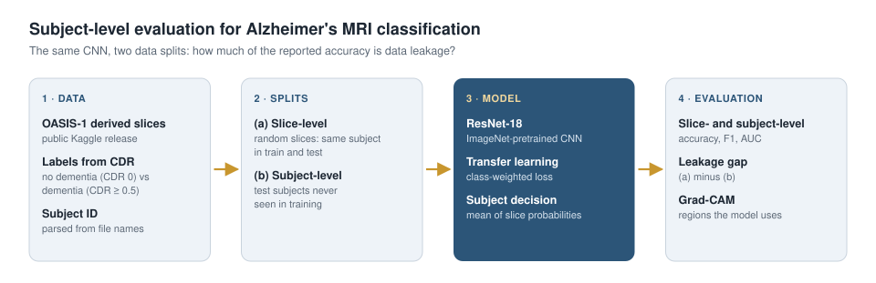

# Subject-Level Evaluation for Alzheimer's MRI Classification

**Measuring the effect of data leakage** in dementia classification from brain MRI slices: the same model is trained with slice-level and subject-level data splits and compared, and the regions it focuses on are visualized with **Grad-CAM**.

<p align="center"></p>

> **Status:** Work in progress. Result tables will be added as experiments are completed.
>
> This is an independent learning and reproduction project on publicly available data. It is not intended for clinical use.

## Problem

Popular Alzheimer's MRI datasets on Kaggle consist of many 2D slices extracted from each subject's brain volume. When slices are split at random, nearly identical neighboring slices of the same subject end up in both the training and test sets. The model learns to recognize the *subject* rather than the *disease*, and unrealistically high accuracies (often above 95%) are reported. A sound evaluation requires a **subject-level split**, where test subjects are never seen during training.

## Approach

| Step | Method | File |
|---|---|---|
| 1. Data preparation | Extract the subject ID from the file name; select N evenly spaced slices per subject; binary (no dementia / dementia) or four-class labels | `src/data.py` |
| 2. Slice-level split | Slices are split at random (leaky, common practice) | `src/train.py --split slice` |
| 3. Subject-level split | Subjects are split; all slices of a subject stay in one set | `src/train.py --split subject` |
| 4. Model | ImageNet-pretrained ResNet-18, transfer learning, class-weighted loss; model selection on the validation set | `src/train.py` |
| 5. Subject-level decision | One decision per subject from the mean of its slice probabilities | `src/train.py` |
| 6. Interpretability | Grad-CAM heatmaps of the regions the model attends to | `src/gradcam.py` |


## Data

- [OASIS Alzheimer's Detection](https://www.kaggle.com/datasets/ninadaithal/imagesoasis) (Kaggle): 2D slices derived from the OASIS-1 cross-sectional MRI data; classes based on CDR: Non Demented, Very mild Dementia, Mild Dementia, Moderate Dementia.
- The subject ID is read from the `OAS1_XXXX` pattern in the file name (configurable via `--subject-regex`).
- Because the moderate dementia class contains very few subjects, the default evaluation is **binary**: no dementia (CDR 0) vs. dementia (CDR ≥ 0.5).
- No data is included in this repository; the data is subject to the OASIS data use terms.

## Installation

```bash
git clone https://github.com/mahdildarr/alzheimer-mri.git
cd alzheimer-mri
pip install -r requirements.txt
```

The quickest way to run everything is the `notebooks/colab_alzheimer_mri.ipynb` notebook on Google Colab (GPU enabled).

## Usage

```bash
# 1) Same settings, two different splits
python src/train.py --root <data folder> --split slice --epochs 8
python src/train.py --root <data folder> --split subject --epochs 8

# 2) Comparison table
python src/report.py --runs runs/slice runs/subject

# 3) Grad-CAM
python src/gradcam.py --run runs/subject --n 8
```

## Evaluation metrics

- Slice level and subject level: accuracy, balanced accuracy, macro-F1, ROC-AUC, confusion matrix
- Leakage check: number of subjects present in both train and test sets (must be 0 for the subject-level split)

## Results

| Split | Train ∩ test subjects | Slice accuracy | Subject accuracy | Subject macro-F1 | Subject AUC |
|---|---|---|---|---|---|
| Slice-level (leaky) | _TBD_ | _TBD_ | _TBD_ | _TBD_ | _TBD_ |
| Subject-level | 0 | _TBD_ | _TBD_ | _TBD_ | _TBD_ |

## Roadmap

- [x] Data preparation, both split strategies, subject-level metrics and Grad-CAM
- [ ] Binary classification experiments
- [ ] Effect of the number of slices per subject
- [ ] Subject-level k-fold cross-validation

## Project structure

```
├── notebooks/colab_alzheimer_mri.ipynb
├── src/
│   ├── data.py       # scanning, subject IDs, slice selection, splits
│   ├── train.py      # training and slice / subject-level evaluation
│   ├── report.py     # comparison table
│   └── gradcam.py    # Grad-CAM visualization
└── requirements.txt
```

## References

- Marcus et al., *Open Access Series of Imaging Studies (OASIS): Cross-sectional MRI Data in Young, Middle Aged, Nondemented, and Demented Older Adults*, Journal of Cognitive Neuroscience, 2007
- Wen et al., *Convolutional neural networks for classification of Alzheimer's disease: Overview and reproducible evaluation*, Medical Image Analysis, 2020
- [3D MRI-Based Alzheimer's Disease Classification Using Multi-Modal 3D CNN with Leakage-Aware Subject-Level Evaluation](https://arxiv.org/abs/2603.17304), arXiv, 2026
- Selvaraju et al., *Grad-CAM: Visual Explanations from Deep Networks via Gradient-based Localization*, ICCV 2017

## License

MIT (code). The data is subject to the OASIS data use terms.
